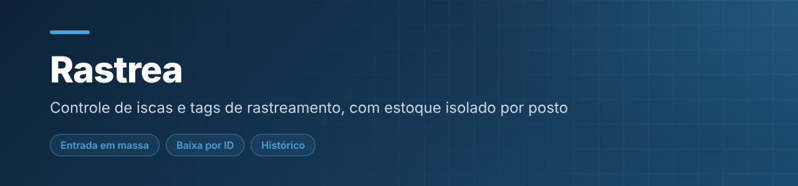
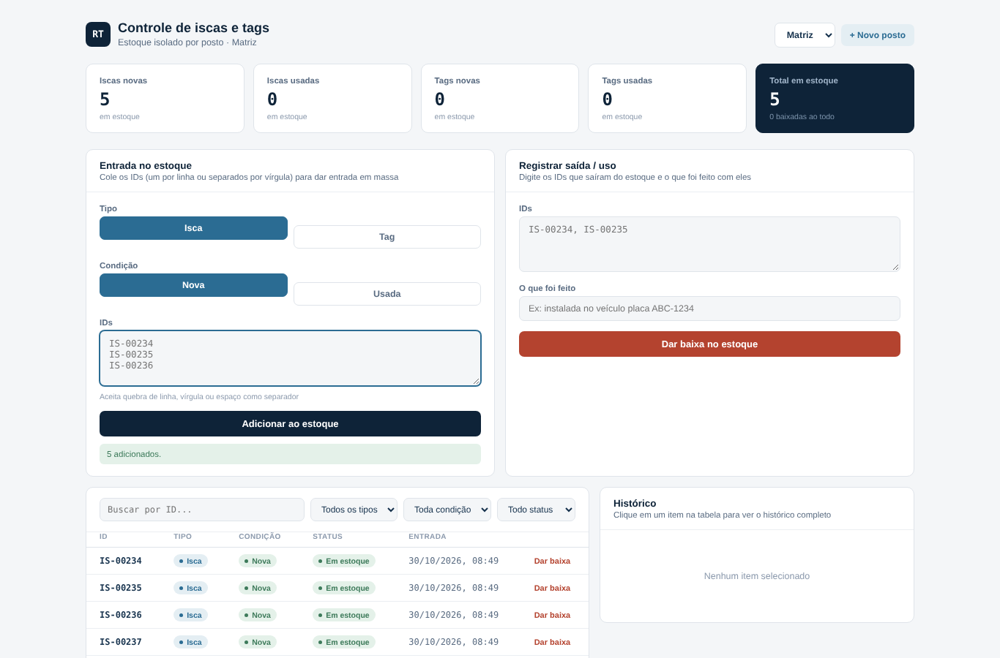

  

<h1 align="center">Rastrea · Controle de Iscas e Tags de Rastreamento</h1>

Controle de estoque de ativos de rastreamento (iscas e tags), com estoque isolado por posto.

  

    

---

## 📌 Sobre

Ferramenta pensada para a rotina de quem controla ativos de rastreamento: dar entrada em lote, registrar o que foi feito com cada item na baixa e consultar o histórico completo por ID.

## 🖼️ Demonstração

  
   Entrada em massa de IDs e lista de itens em estoque

## ✨ Funcionalidades

- Entrada em massa colando IDs (um por linha, vírgula ou espaço), com tipo (isca/tag) e condição (nova/usada)
- Totais separados por tipo e condição, mais total geral em estoque
- Baixa por ID, individual ou em massa, registrando o que foi feito
- Histórico completo de cada item e filtros por tipo, condição e status
- Vários **postos** com estoque isolado, sem misturar os dados

## 🛠️ Tecnologias

`HTML5` · `CSS3` · `JavaScript` · `localStorage`

## ▶️ Como usar

Abra a demo, ou baixe o repositório e abra o `index.html` no navegador. Crie um posto, dê entrada nos IDs e registre as baixas.

Não precisa instalar nada nem rodar servidor: é só HTML, CSS e JavaScript.

## 📝 Observações

Os dados ficam salvos no navegador (`localStorage`), portanto não são compartilhados entre computadores.

---

## 👤 Autor

**Daniel da Silva Rezende** — estudante de Engenharia de Software e Análise e Desenvolvimento de Sistemas.

